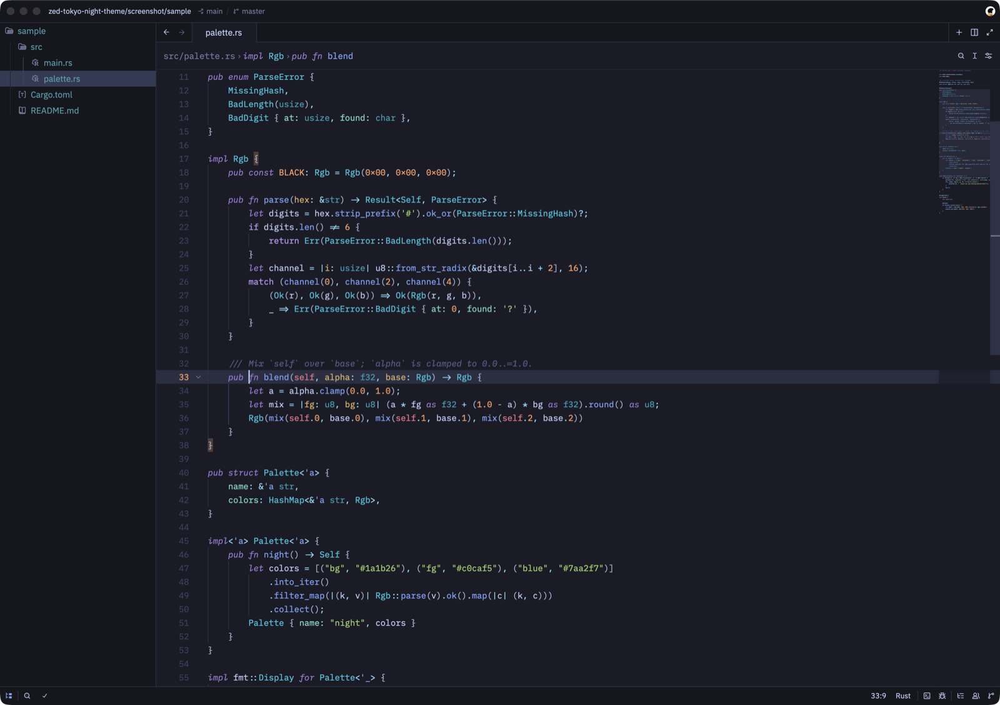
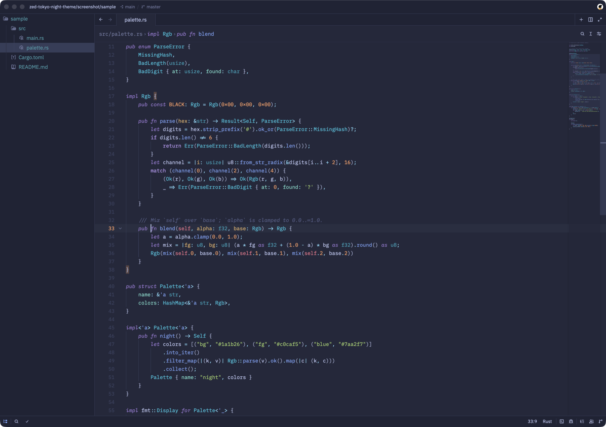
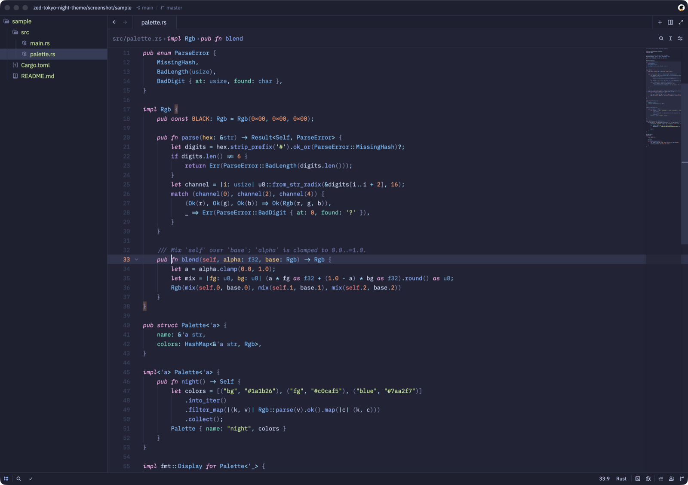
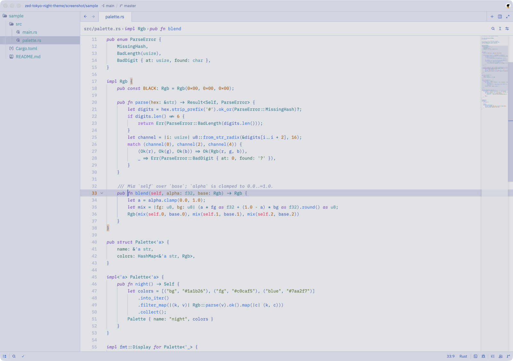

# TokyoNight for Zed

Tokyo Night for Zed with the syntax colors of
[folke/tokyonight.nvim](https://github.com/folke/tokyonight.nvim), and window
chrome built the way Zed's own themes are.



| Storm | Moon | Day |
| --- | --- | --- |
|  |  |  |

## Why another Tokyo Night

If you use tokyonight.nvim, or a terminal theme generated from it (Ghostty,
kitty, WezTerm, tmux…), the existing Zed themes don't quite match:

- **Syntax.** The existing Zed ports follow the VS Code theme's colors. tokyonight.nvim
  has diverged from those: a brighter foreground (`#c0caf5`), italic keywords,
  its own choices for parameters, properties, builtins and markdown. This theme
  doesn't copy colors at all: it loads tokyonight.nvim in headless Neovim and
  reads back the highlight groups nvim actually applies, so Zed shows what nvim
  shows.
- **Chrome.** The popular port draws every border in near-black `#101014`
  against the blue background and lights the active tab in a bright slate.
  Here, surfaces are separated by brightness the way Zed's built-in themes do it:
  the editor and the active tab share the editor background, the tab bar,
  panels, title and status bars sit one step darker, and dividers are a dim blue
  rather than black. The vim mode indicator stays plain text, as in Zed's own
  themes.

Selection, search, git, diff, diagnostic and terminal colors all come from the
tokyonight.nvim palette, in all four styles: Night, Storm, Moon and Day.

## Install

Until it's in the extension registry, either:

- Copy `themes/tokyonight.json` into `~/.config/zed/themes/`, or
- Clone this repo and run `zed: install dev extension` on it.

Then choose `TokyoNight Night`, `Storm`, `Moon` or `Day` in the theme selector.

## How it works

`generate.lua` runs inside `nvim --clean -l`, applies each tokyonight style and
writes one Zed theme family, `themes/tokyonight.json`.

- **Syntax.** Each Zed capture name (`function.method`, `string.special.symbol`…)
  maps to the treesitter group nvim uses for the same thing (the `syntax`
  table). Both editors fall back along the dotted name, so only differing
  spellings are listed. Groups are resolved through links, so italics and bold
  carry over.
- **Chrome.** The `ui` function derives every Zed UI color from the palette
  (`bg`, `bg_dark`, `fg_gutter`, `bg_visual`, `git.*`, `diff.*`, `terminal.*`).
  Change it there and rebuild.

```sh
just build        # regenerate themes/tokyonight.json
just install      # build and copy into ~/.config/zed/themes
just screenshots  # re-render screenshots/*.png
```

`TOKYONIGHT=/path/to/tokyonight.nvim` selects the checkout to generate from;
the default is where Neovim's built-in package manager installs it.

### Screenshots

`screenshot/capture.sh` renders the images above without disturbing a running
Zed. For each style it starts a throwaway Zed in the background
(`ZED_STATELESS=1` skips Zed's one-instance check; `--user-data-dir` gives it
its own settings), opens `screenshot/sample`, finds that process's window
through CoreGraphics and captures only that window with `screencapture -l`.
The window never takes focus. macOS asks once for Screen Recording permission
for your terminal.

## License

Apache-2.0, as is [tokyonight.nvim](https://github.com/folke/tokyonight.nvim),
whose palette and highlight groups this generates from.
